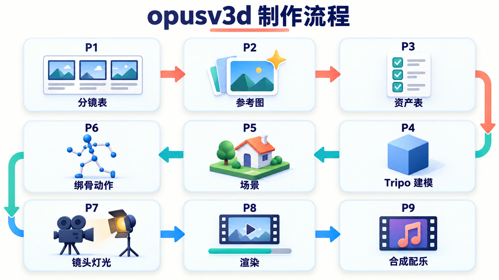
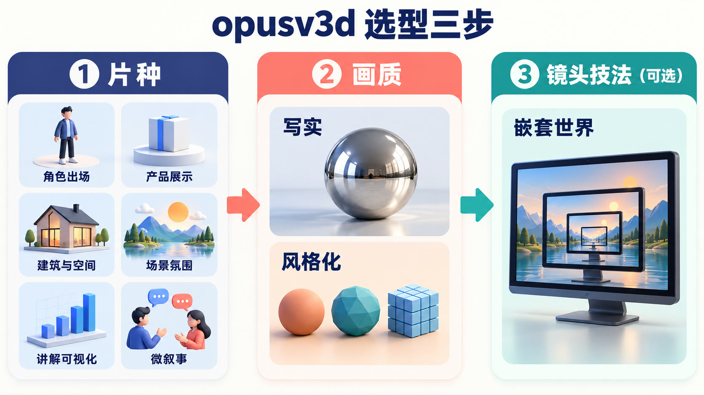
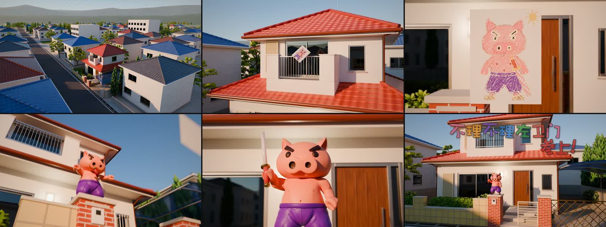
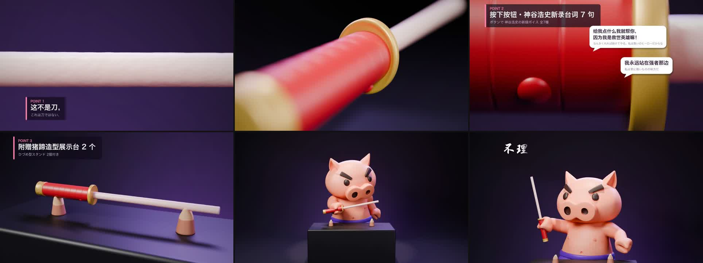

# opusv3d

Claude Code skill。用代码做 3D 短片。

流程：参考图 → Tripo / Blender 建模 → 绑骨手 K → 灯光 → `timeline.json` → 合成、配乐、接缝检查。



阶段手册见 [`references/hifi.md`](references/hifi.md)。每个片种做哪些阶段，见该文件开头的"片种与阶段"表。

## 选型

选型分三步。三步互相独立，可以任意组合。



| 步骤 | 选项 |
|---|---|
| 片种 | 角色出场、产品展示、建筑与空间、场景氛围、讲解可视化、微叙事 |
| 画质 | 写实（Cycles，`film` look）；风格化（EEVEE，8 种 look：黏土、体素、低多边形、玻璃、纸、卡通、霓虹、微缩） |
| 镜头技法（可选） | 嵌套世界：穿屏、键帽、书页进入另一个世界 |

验证状态：

- 已验证：角色出场（30 s 成片，seamcheck 通过）。
- 部分验证：产品展示、建筑与空间（只有住宅外景）。
- 未验证：场景氛围、讲解可视化、微叙事。先出 1 个镜头的静帧给用户确认，再往下做。

## 示例

两部用本 skill 做的成片。下面每张图是从成片里按时间顺序抽的 6 帧。

### 角色出场（写实画质）

30.0 s，6 个镜头，24 fps，1920×1080，Cycles 128 采样。故事：蜡笔画从阳台飘出，画里的角色升维成 3D，跳到门柱上，拔刀亮相，片名出现。



### 产品展示（写实画质）

30.0 s，7 个镜头，24 fps，1920×1080，Cycles 128 采样。影棚光，微距运镜，卖点字幕，结尾角色持刀亮相。



示例里的角色和商品造型，权利属于各自的权利人。这些成片只用于提案和内部展示，不对外发布。

## 安装

把整个目录复制到 Claude Code 的 skills 目录。

```sh
# 项目级
cp -R opusv3d <你的项目>/.claude/skills/opusv3d
# 或用户级
cp -R opusv3d ~/.claude/skills/opusv3d
```

之后在 Claude Code 里说「3D 短片」「角色出场」「产品片」「3D 转场」等，或直接调用 `opusv3d`。

## 依赖

| 需要 | 说明 |
|---|---|
| Blender 5.x | 已测 5.2.1。4.x 不能用。路径不是 `/Applications/Blender.app/...` 时设 `BLENDER=...` |
| lemo-opuscar 库和它的 `.venv` | 提供 numpy、scipy、pillow、soundfile，以及 `sfx.py`、`sheet.py`、`mux.sh`。库不在默认位置时设 `LEMO_OPUSCAR_HOME=...`。本 skill 不修改它的任何文件 |
| ffmpeg | 合成与封装 |
| Codex CLI | 出参考图（`scripts/gptimg.sh`）。讲解可视化可以不要 |
| Auto-Rig Pro 插件 | 只有绑骨一步要。没有时改用 Mixamo |
| Tripo 账号 | 角色、产品等需要 Tripo 资产的片种。多视角生成要付费订阅；免费版输出不能商用 |

## 快速开始

```sh
# 嵌套世界示例（22 s）
sh scripts/new.sh my-film
# 其他片种：空骨架
sh scripts/new.sh --blank my-film

cd my-film
sh build.sh --draft      # 草稿 960×540
sh build.sh              # 正式 1920×1080，先让用户确认关键帧
```

`new.sh` 会复制模板和一份冻结的引擎到项目里。之后改 skill 的引擎，不会影响旧片。

## 目录

| 路径 | 内容 |
|---|---|
| `SKILL.md` | 入口：选型、流程、命令、`timeline.json` 字段、规则、验收 |
| `references/hifi.md` | 阶段手册 P1–P9（所有片种共用） |
| `references/grammar.md` | 嵌套世界的设计语法 |
| `references/transitions.md` | 转场生成器目录与参数 |
| `references/generalize.md` | 8 种风格化 look；嵌套世界的题材世界链 |
| `references/teardown.md` | 样片拆解（证据） |
| `engine/v3d/` | 引擎：Film、World、转场、关键帧、相机、形体、几何节点、look、建筑、材质、Tripo 资产、绑骨 |
| `engine/compose.py` `seamcheck.py` | 合成；成片检查 |
| `engine/review.py` `motioncheck.py` | 截图审阅（帧条、指定帧、速度曲线） |
| `engine/assettool.py` `arptool.py` | 资产检查、Mixamo 上传准备；ARP 绑骨 |
| `templates/starter/` | 嵌套世界示例片 |
| `templates/blank/` | 空骨架 |
| `scripts/new.sh` | 新建项目 |
| `scripts/gptimg.sh` | 用 Codex CLI 出一张参考图 |

## 验收原则

- **画面是最后的判定。** 数字和画面冲突时，以画面为准。
- 宣称完成之前，必须实际运行 `seamcheck.py`，并检查响度（−14 LUFS，峰值 < −1 dBFS）。
- 快速动作用 `review.py strip` 每帧一格地看，不抽样。
- 每个出图阶段结束时，派独立子 Agent 盲审。高级问题 = 0 才算通过。

详见 `SKILL.md` 第 6 节。

## 已知限制

- 风格化 look 只作用于 `shapes`、`arch` 生成的物体和灯光。导入的 Tripo / ARP 角色保留自带 PBR 材质。
- 写实画质（`film` look）下不要用传送门，会被调色两次。
- `overlays`（字幕、标注）固定在屏幕位置，不跟踪 3D 物体。
- 建筑：没有室内、楼梯、家具和漫游的现成构件。
- 同一个项目不要同时跑两个渲染。
